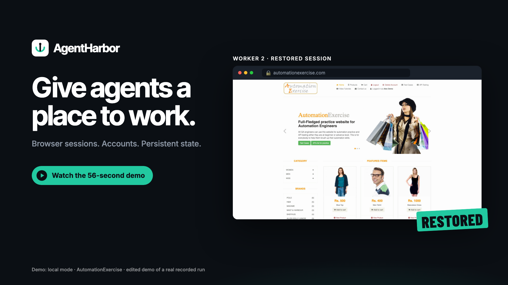
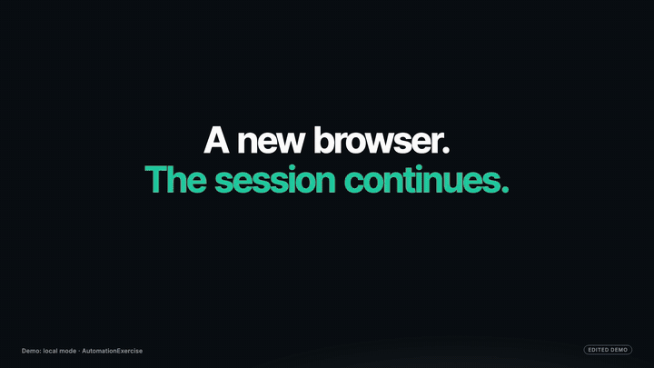
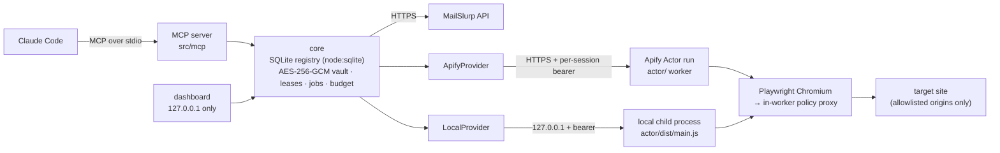

<!-- AgentHarbor README. Animated art lives in assets/readme/ (hand-written SVG, regenerate with `node assets/readme/generate.mjs`). -->

<div align="center">

<picture>
  <source media="(prefers-color-scheme: dark)" srcset="assets/readme/hero-dark.svg" />
  <source media="(prefers-color-scheme: light)" srcset="assets/readme/hero-light.svg" />
  
</picture>

<br/>

**AgentHarbor gives Claude a real browser, website accounts it can keep, and logins that survive a restart.** It is a Claude Code plugin that runs as a local MCP server. Passwords never pass through chat, an account never runs in two sessions at once, and every run reports where it ran and what is still uncertain.

<br/>

[](#quick-start)
[](#features)
[](#operator-guide)
[](LICENSE)

[](#architecture)
[](#quick-start)
[](#architecture)
[](#operator-guide)
[](#features)
[](#architecture)
[](#operator-guide)

<br/>

[Watch](#watch-it-work) &nbsp;·&nbsp; [How it works](#how-it-works) &nbsp;·&nbsp; [Features](#features) &nbsp;·&nbsp; [Evidence](#evidence) &nbsp;·&nbsp; [Architecture](#architecture) &nbsp;·&nbsp; [Quick start](#quick-start) &nbsp;·&nbsp; [Operator guide](#operator-guide)

</div>

<br/>


## Watch it work

<div align="center">

<a href="docs/demo/agentharbor-product-film.mp4"></a>

<sub><b><a href="docs/demo/agentharbor-product-film.mp4">▶ Product film, 56 s, sound on</a></b> &nbsp;·&nbsp; <a href="docs/demo/agentharbor-demo-full-chronological.mp4">Full chronological recording, 71 s</a> &nbsp;·&nbsp; <a href="docs/demo/agentharbor-demo-presentation.mp4">Captioned cut, 63 s</a> &nbsp;·&nbsp; <a href="docs/demo/README.md">Run log and methodology</a></sub>

</div>

One real run on the public practice site automationexercise.com (2026-10-27, `local` mode). **Claude drove it through AgentHarbor's MCP tools** and nobody typed in the browser. It covers signup, logout and re-login, saving the session, closing worker 1, restoring the session in a new worker 2, deleting the account on the site, and confirming the deletion. The film is an edited cut with an AI-generated voice-over and music: its speed changes, held frames and illustrative graphics are labeled and [documented](docs/demo/README.md#product-film). The chronological recording is unedited apart from redactions.


## The problem

> **Agent:** I need to log in to finish this.<br/>
> **You:** don't paste the password into chat.<br/>
> **Agent:** and tomorrow I'll have to log in all over again.

Agents that work on the web need three things a chat window can't give them: a browser, an account, and a login that outlives the session. AgentHarbor provides all three as MCP tools, with the credentials kept out of the conversation.

<table>
<tr>
<td width="50%" valign="middle">

### A new browser. The session continues.

When a session ends, `session_save_state` encrypts its cookies and localStorage into the account (AES-256-GCM). Later, `session_start {accountId}` launches a **new worker process** with those cookies, and the site already shows you as logged in. No credentials are entered again.

In the recorded run, worker 1 saved 2 cookies and closed without logging out. Worker 2 opened the site as "Logged in as Alex Demo" with **zero credential fills**.

When a password is needed, `browser_fill` types it from a stored **secret reference**. Neither Claude nor the transcript ever sees the value.

</td>
<td width="50%" valign="middle" align="center">



</td>
</tr>
</table>

<div align="center">

<br/>
<sub>From the product film: worker 2's real footage, restored without re-entering credentials. The card above is an illustration.</sub>
</div>


## How it works

<picture>
  <source media="(prefers-color-scheme: dark)" srcset="assets/readme/how-it-works-dark.svg" />
  <source media="(prefers-color-scheme: light)" srcset="assets/readme/how-it-works-light.svg" />
  
</picture>

1. **Sign up.** `account_register` fills the public signup form of an **authorised** target with a synthetic identity and a generated password. It submits exactly once and follows a verification email through a real MailSlurp inbox when the site sends one.
2. **Log in.** `browser_fill {secret: "account_email" | "account_password"}` types the stored credentials. The values never come back to Claude.
3. **Save state.** `session_save_state` encrypts the session's cookies and localStorage into the account.
4. **Restore.** `session_start {accountId}` starts a fresh worker with that state, with the account's lease held and its execution mode enforced.
5. **Clean up.** Delete the account on the site, then `account_delete {deleteInbox: true}` removes the local record and the inbox.


## Features

<table>
<tr>
<td width="50%" valign="top">

#### 🧭 Browser sessions
- `session_start` in one of three [execution modes](#operator-guide): `local`, `remote_direct`, `remote_proxy`. A session never falls back to another mode.
- `browser_navigate`, `browser_inspect`, `browser_click`, `browser_fill`, `browser_select`, `browser_screenshot`, `scrape_extract`, bounded `crawl_start`.
- Page text comes back marked **untrusted**, so instructions on a page are not obeyed.
- <sub>**Live** on public practice sites in all three modes.</sub>

#### 🔐 Accounts and credentials
- AES-256-GCM vault for passwords and browser state. **Secret references** only: passwords are never returned.
- Exclusive **leases**: one job per account at a time.
- Each account is bound to the execution mode (and proxy) it was created in.
- <sub>**Live** signup, login, re-login and restore on 3 practice sites ([qualifications](#evidence)).</sub>

#### ✉️ Email
- Real MailSlurp inboxes, `kept` or `disposable`, bound to the site they serve.
- Verification links and codes are followed remotely by the signup job.
- <sub>Inboxes: **live**. Site-sent verification email: **owned fixture only**.</sub>

</td>
<td width="50%" valign="top">

#### ♻️ Persistent state
- `session_save_state` and restore in a new worker, with zero credential fills.
- `account_delete` removes only the local record (and the inbox); the result says so (`websiteAccount: "not_deleted"`).
- <sub>**Live**: restore with zero fills on all 3 practice sites.</sub>

#### 🧹 Files and uploads
- Removes metadata from JPEG, PNG, WebP, PDF, MP3, FLAC, WAV, M4A and MP4/MOV into a new artifact, verified afterwards.
- `portal_upload` checks the destination's file hash.
- <sub>Fixture tests per format; **live** for one synthetic JPEG; upload on the **owned fixture**.</sub>

#### 🛡️ Guardrails (enforced in code)
- Exact-origin allowlists for navigation, subresources and signup targets, including on redirects.
- Private, loopback and metadata addresses blocked unless explicitly allowed.
- Signup is a state machine: it never resubmits after a possible submission.
- It **stops** on HTTP 403/429 or human verification and never tries to bypass a CAPTCHA.

</td>
</tr>
</table>

<details>
<summary><b>What the plugin enforces vs. what Claude decides</b></summary>

<br/>

| The plugin enforces (in code) | Claude (the "operator agent") decides |
|---|---|
| Exact-origin allowlists for navigation, subresources and signup targets | Which pages to open and which selectors to use |
| Encrypted storage, secret references (passwords never returned), one lease per account | Form field mapping, `successText` and `rejectionTexts` |
| Signup job state machine: submits once, never resubmits after a possible submission | Usernames (filled as plain values; see limitations) |
| Block detection: stops on HTTP 403/429 or a visible human-verification challenge | Whether to report, retry or lift a quarantine, always with the **user's** approval |
| No fallback between execution modes, proxies or accounts | Which execution mode to request |

In the 2026-10-27 runs, Claude's own choices shaped the results: its rejection word `Invalid` caused the ExpandTesting false failure. The server exposes 48 tools (`src/mcp/tools/`); in Claude Code they appear as `mcp__plugin_remote-browser-accounts_remote-browser__<tool>`.

</details>


## Evidence

Live runs of build `0.1.0+7b11081` on 2026-10-27 ([summary](docs/evidence/signup-compat-2026-10-27/README.md), [raw log](docs/evidence/signup-compat-2026-10-27/evidence-log.md)), plus the controlled fixture from [docs/LIVE-RESULTS.md](docs/LIVE-RESULTS.md). These are practice sites and our own fixture; **they say nothing about other sites.**

| Run | Signup | Email verification | Login | Restore, 0 fills | Deleted on site | Local cleanup | Intervention |
|---|:---:|:---:|:---:|:---:|:---:|:---:|---|
| AutomationExercise | ✅ | not sent | ✅ | ✅ | ✅ | ✅ | **none** |
| ↳ recorded demo, `local` ([log](docs/demo/README.md)) | ✅ | not sent | ✅ | ✅ | ✅ | ✅ | **none** during the run |
| ExpandTesting | ✅¹ | not sent | ✅ | ✅ | ❌² | ✅ | operator lifted a quarantine |
| ParaBank | ❌→✅³ | not sent | ✅ | ✅ | ❌² | ✅ | user-approved resubmit via residential proxy |
| Owned fixture | ✅ | ✅ | — | ✅ | n/a | ✅ | none recorded |

<sub>¹ The signup succeeded, but the plugin reported a false rejection. ² The site has no delete option. ³ The first attempt got HTTP 403 / human verification; the second passed through a different route. "Deleted on site" was confirmed by a refused login afterwards.</sub>

- **No manual browser input** in any run. **No human or operator intervention** only on AutomationExercise.
- **No CAPTCHA or challenge was solved.** ParaBank's second attempt used a different route, chosen by the user, that the site did not challenge.
- **Local cleanup is not external cleanup.** Test accounts `rbaexp1cd1b9` (ExpandTesting) and `rbapb9d9db2` (ParaBank) remain; the status of `rbapbc863a1` (ParaBank, the 403 attempt) is unknown.
- Website-generated verification email has been proven **only against our own fixture**.


## Architecture



| Path | What lives there |
|---|---|
| `src/mcp` | MCP server and the 48 tool definitions |
| `src/core` | Config, registry, vault, leases, sessions, jobs, budget |
| `src/providers` | `ApifyProvider` (remote) and `LocalProvider` (child process on this computer) |
| `actor/` | The worker: Playwright Chromium behind an in-worker policy proxy, the same code locally and on Apify |
| `src/dashboard` | Local dashboard (127.0.0.1): enter existing passwords outside chat, and see jobs and usage |
| `video/` | Remotion source of the product film ([render instructions](video/README.md)) |

One Apify Actor run is one browser session. MailSlurp is called from the MCP server, never from the worker. Every browser request passes the policy proxy before a connection opens. Design details: [docs/REFERENCE.md](docs/REFERENCE.md) · modes: [docs/MODES.md](docs/MODES.md) · review: [docs/REVIEW.md](docs/REVIEW.md).


## Quick start

You need Node ≥ 22.13, npm ≥ 10, Claude Code with plugin support, and your own Apify and MailSlurp accounts (no credentials ship with the plugin). Only macOS arm64 has been tested ([platforms](docs/PLATFORMS.md)).

```sh
npm run setup          # npm ci (root + actor/), build, then init-env (writes .env, mode 600, generated keys)
npm run check-config   # names of missing variables per capability (never values)
npm run deploy-actor   # deploys your private worker Actor; prints APIFY_ACTOR_ID
claude plugin marketplace add "$(pwd)" && claude plugin install remote-browser-accounts@remote-browser-accounts-local
```

Then ask Claude: *"Start a remote browser session, open https://automationexercise.com/products, extract each product's name and price, then close the session."* The [pipeline skill](skills/pipeline/SKILL.md) (`/remote-browser-accounts:pipeline <task>`) handles the full flow.

> [!WARNING]
> **Install it as a plugin, and don't load the repo's `.mcp.json` as a project server.** The file uses `${CLAUDE_PLUGIN_ROOT}`, which is set only for plugins. When Claude Code is opened inside this folder, it also loads `.mcp.json` as a project server named `remote-browser`, which fails with `CONNECTION_CLOSED`. Keep `plugin:remote-browser-accounts:remote-browser`, and add `"disabledMcpjsonServers": ["remote-browser"]` to `.claude/settings.local.json`. Don't set `enabledMcpjsonServers: ["remote-browser"]` or `enableAllProjectMcpServers: true`.

`.env` values are yours to fill in; never paste them into chat. Install paths, data location, upgrades and backups: **[docs/INSTALL.md](docs/INSTALL.md)**.


## Operator guide

Every section below is the full reference. Click to expand.

<details>
<summary><b>Configuration</b></summary>

<br/>

`.env` lookup order (first found wins): `RBA_ENV_FILE` → `$CLAUDE_PLUGIN_DATA/.env` → the user config folder (`$RBA_CONFIG_HOME`, else `$XDG_CONFIG_HOME/remote-browser-accounts`, else `~/.config/remote-browser-accounts/.env`, recommended) → `$CLAUDE_PLUGIN_ROOT/.env` → the checkout's `.env`. The data folder sits next to its `.env`. **Back them up together:** the key in `.env` is the only way to decrypt stored accounts.

| Variable | Required? | Purpose |
|---|---|---|
| `APIFY_TOKEN`, `APIFY_ACTOR_ID` | Remote modes | Your Apify token; the Actor id printed by `npm run deploy-actor` |
| `MAILSLURP_API_KEY` | Email and `account_register` | Your MailSlurp key |
| `RBA_ENCRYPTION_KEY` | Yes (generated) | Vault key for credentials and browser state |
| `RBA_DASHBOARD_TOKEN` | Dashboard (generated) | Dashboard sign-in |
| `RBA_AUTHORIZED_TARGETS` | Signup and accounts | Signup/account target origins, see allowlists |
| `RBA_ALLOWED_ORIGINS` | Browsing without an account | Navigation allowlist; empty means no navigation |
| `RBA_SUBRESOURCE_ORIGINS`, `RBA_ALLOW_PRIVATE_HOSTS` | Optional | Extra resource origins; explicitly authorised private test hosts |
| `RBA_DEFAULT_EXECUTION_MODE`, `RBA_DEFAULT_PROXY_MODE`, `RBA_PROXY_COUNTRY` | Optional | Default route |
| `RBA_MONTHLY_BUDGET_USD`, `RBA_MAX_*`, `RBA_*_TIMEOUT_SECS` | Optional | Budget and limits (conservative defaults) |
| `RBA_INBOX_EXPIRES_HOURS`, `RBA_MAILSLURP_*` | Optional | Inbox lifetime and monthly caps |
| `RBA_IMPORT_ROOTS`, `RBA_UPLOAD_ROOTS`, `RBA_MAX_IMPORT_MB` | Optional | Which local files the plugin may read |
| `RBA_OPERATIONS_ENABLED` | Optional (off) | Saved read operations ([docs](docs/OPERATIONS.md)) |
| `RBA_LOCAL_RECORD_VIDEO_DIR` | Optional (off) | Record `local`-mode worker pages as `.webm` (demos) |
| `RBA_DISPLAY_NAME` | Optional | UI label only, e.g. `AgentHarbor` |

Every variable with its default is in [.env.example](.env.example).

```bash
APIFY_TOKEN=REPLACE_ME
APIFY_ACTOR_ID=REPLACE_ME
MAILSLURP_API_KEY=REPLACE_ME
RBA_AUTHORIZED_TARGETS=https://app.example.com|https://auth.example.com
RBA_ALLOWED_ORIGINS=https://app.example.com
```

</details>

<details>
<summary><b>Tool calls, step by step</b></summary>

<br/>

```text
config_check {}                                   # missing variable NAMES, build identity, signup targets

# 1. Inspect the signup page (origin must be in RBA_ALLOWED_ORIGINS)
session_start    { mode: "remote_direct" }
browser_navigate { sessionId, url: "https://app.example.com/signup" }
browser_inspect  { sessionId }                     # element refs + visible text (marked untrusted)
session_close    { sessionId }

# 2. Register one synthetic test account (origin must be in RBA_AUTHORIZED_TARGETS)
account_register {
  targetOrigin: "https://app.example.com",
  signupUrl:    "https://app.example.com/signup",
  fields: [ { selector: "#email",    value: { secret: "email" } },
            { selector: "#password", value: { secret: "password" } } ],
  submitSelector: "button[type=submit]",
  successText: "Account created",
  rejectionTexts: ["already registered"],          # specific phrases; see limitations
  verification: { required: false },               # or { linkContains: "/verify", successText: "Email verified" }
  synthetic: true, emailMode: "disposable",
  idempotencyKey: "signup-app-example-001", waitSecs: 100 }
job_status { jobId, waitSecs: 100 }                # until terminal

# 3. Log in with stored credentials, then save the browser state
session_start      { accountId }
browser_navigate   { sessionId, url: "https://app.example.com/login" }
browser_fill       { sessionId, selector: "#email",    secret: "account_email" }
browser_fill       { sessionId, selector: "#password", secret: "account_password" }
browser_click      { sessionId, selector: "button[type=submit]", waitForNavigation: true }
session_save_state { sessionId }
session_close      { sessionId }

# 4. Restore later without logging in: the response shows restoredBrowserState: true
session_start { accountId }

# 5. Remove the LOCAL record and its inbox (the website account is NOT deleted)
account_delete { accountId, confirmAccountId: accountId, deleteInbox: true }
```

`account_register` fields take `{secret: "email" | "password" | "display_name"}`; `browser_fill` takes `secret: "account_password" | "account_email" | "verification_code"`. Job states (`completed`, `completed_unconfirmed`, `outcome_unknown`, `blocked`, …) are described in `job_status`. Files and uploads: [docs/FILES.md](docs/FILES.md).

</details>

<details>
<summary><b>Execution modes</b></summary>

<br/>

| Mode | Browser runs in | Requests come from | Route check |
|---|---|---|---|
| `remote_direct` (default) | Apify Actor run | Apify worker IP | None (IP reported for information) |
| `remote_proxy` | Apify Actor run | Apify `datacenter` or `residential` proxy, optional country | Required: refused unless the egress IP differs from the worker's direct IP |
| `local` | Child process on this computer, fresh temporary profile | This computer's network | None |

**Guaranteed:**
- No fallback between modes, proxies or accounts.
- An account stays bound to its mode (and proxy kind and country).
- `local` never touches your personal browser profile.

**Not guaranteed:**
- **No mode is anonymous or undetectable.** "Verified" in `remote_proxy` means only that the IPs differed at session start.
- In proxy modes, DNS lookups for the policy check still leave from the container's resolver.

Details: [docs/MODES.md](docs/MODES.md).

</details>

<details>
<summary><b>Exact-origin allowlists and testing scope</b></summary>

<br/>

Use AgentHarbor only on sites you are **authorised** to test. Entries are exact origins (scheme and port must match).

| Setting | Controls | Syntax |
|---|---|---|
| `RBA_AUTHORIZED_TARGETS` | Where accounts may be created or used, and which origins verification links may open | `https://app.example.com\|https://auth.example.com,https://other.test` |
| `RBA_ALLOWED_ORIGINS` | Main-frame navigation for sessions **without** an account | Comma-separated; empty = none; `*` only explicitly |
| `RBA_SUBRESOURCE_ORIGINS` | Extra origins for iframes, scripts, images, fetch/XHR, WebSockets, workers | Exact origins or `https://*.example.com` |

An account session navigates only to its target and that target's auth origins. To see which hosts a site needs, use `session_network_log`, and add only those.

</details>

<details>
<summary><b>Tests</b></summary>

<br/>

```sh
npm test                 # build + all fixture tests (vitest)
npm run test:unit        # fast unit tests
npm run test:integration # build + integration tests
npm run test:e2e         # build + acceptance suite driving the built MCP server over stdio
npm run typecheck        # server + worker
npm run live-check -- --browser | --proxy=residential | --email   # live, uses Apify/MailSlurp credit
```

On 2026-10-27 (macOS arm64, Node 24): `npm run typecheck` passed, and after `npm run build` the full `vitest run` gave **35 files, 435 tests passed, 1 skipped**. `test:e2e` and `live-check` were not run in that session. Fixture tests exercise the real code against fakes and local fixture sites. **They are engineering checks, not compatibility evidence.** Proof level per requirement: [docs/ACCEPTANCE.md](docs/ACCEPTANCE.md).

</details>

<details>
<summary><b>Known limitations</b></summary>

<br/>

- **CAPTCHAs and human verification:** never solved or bypassed, and there is no stealth mode. On HTTP 403/429 or a challenge, the job ends `blocked` and the account is marked blocked or quarantined.
- **Every signup gets an inbox**, even on sites that never ask for an email, and it counts against the MailSlurp quota.
- **`config_check` doesn't list the configured navigation allowlist.** It names `RBA_ALLOWED_ORIGINS` only when that is empty; `session_start` returns `allowedNavigationOrigins`.
- **Rejection words match the whole page.** A word in the page's own static text can mark a successful signup as rejected and quarantine the account.
- **No username secret:** usernames are filled as plain values.
- **Main frame only** for element targeting.
- **Proxies:** only on Apify; the egress check compares IPs only; sticky sessions don't guarantee one IP; the residential reserve is not a hard cap.
- **Email:** the sender check reads MailSlurp's `From` address (no DKIM). Click-tracking link domains must be added as auth origins.
- **Platforms:** only macOS arm64 (Node 24.7) has been tested. `local` mode needs a source checkout.
- **Recording:** `RBA_LOCAL_RECORD_VIDEO_DIR` works only for `local` workers, captures only the page viewport, and switches the viewport to 1920×1080 while it is on.
- **`account_delete` doesn't delete the website account** (`websiteAccount: "not_deleted"`).
- The GitHub-hosted marketplace catalog in `release/` has not been tested end to end.

</details>

<details>
<summary><b>Troubleshooting</b></summary>

<br/>

| Symptom | Cause | Fix |
|---|---|---|
| `remote-browser` shows `CONNECTION_CLOSED` | `.mcp.json` loaded as a project server; `${CLAUDE_PLUGIN_ROOT}` unset | Use the plugin server; add `"disabledMcpjsonServers": ["remote-browser"]` |
| Two `remote-browser` entries in `/mcp` | Project copy and plugin both enabled | Keep only the plugin; check `claude plugin list` |
| `.env` or code changes don't take effect | Config and build are read at startup | Rebuild, then reconnect via `/mcp`; `config_check` → `build.loadedBuildMatchesRecord` must be `true` |
| `navigation_blocked: … not in allowedNavigationOrigins` | Origin not in `RBA_ALLOWED_ORIGINS` | Add the exact origin, then reconnect |
| `unauthorized_target` | Origin not in `RBA_AUTHORIZED_TARGETS` | Add it only if you are authorised to test it |
| `egress_unverified` in `remote_proxy` | Proxy route couldn't be verified | By design (fail-closed); try another proxy kind or country |
| Account `quarantined` after an apparently successful signup | A `rejectionTexts` entry matched the page's static text | Check the site; if it succeeded: `account_quarantine { accountId, lift: true, reason }` |
| Job or account `blocked` | HTTP 403/429 or human verification | Stop and report; don't switch account or proxy unless the user decides |
| `config_missing` | Variables missing | `npm run check-config` |
| Server won't start | Node too old, no build, missing dependencies | Read the launcher's stderr line; `npm run doctor` |

</details>

<details>
<summary><b>Project status</b></summary>

<br/>

**Research prototype, `0.1.0`.** Only the source-checkout install path is supported. Results apply to the builds named in the evidence.

**Roadmap (planned, not done):**
- [ ] `config_check` shows the configured navigation allowlist
- [ ] Rejection-text matching scoped to the submit response or a selector
- [ ] A username credential reference for `browser_fill`
- [ ] No inbox for `account_register` on sites that don't ask for an email
- [ ] Test runs on Linux, Windows and Intel macOS
- [ ] An end-to-end test of the GitHub-hosted marketplace path (`release/`)
- [ ] Live testing of verification email from a third-party site

A fixed build gets its own version and its own validation; the 2026-10-27 runs are not evidence for it.

</details>

<br/>

<div align="center">


<sub>MIT licensed ([LICENSE](LICENSE)) · AgentHarbor is the display name of the <code>remote-browser-accounts</code> plugin · Built for authorised testing only.</sub>

</div>
