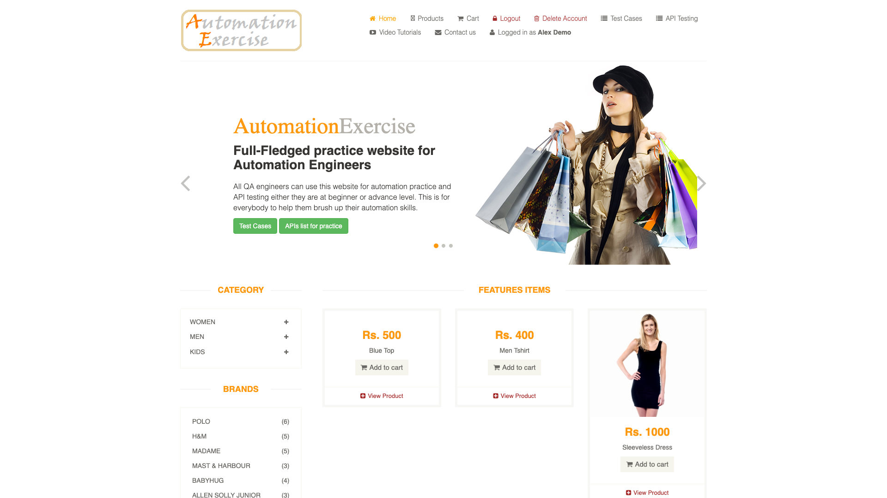
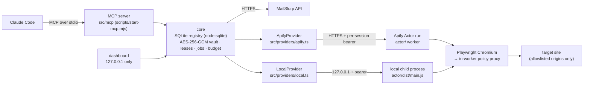

# AgentHarbor

AgentHarbor is a Claude Code plugin and local MCP server (package `remote-browser-accounts`) for web tasks that need a real browser and a real account. Claude gets browser sessions in a remote Apify container or a local worker, encrypted website accounts that only one job can lease at a time, verification email through MailSlurp inboxes bound to their site, saved logins it can restore later, and a metadata-cleaning step for files before a portal upload. Each run reports what happened, where the requests came from and what is still uncertain. **Who it's for:** engineers testing signup, login and upload flows on sites they are **authorised** to test. Passwords never pass through chat, an account never runs in two sessions at once, and the plugin never switches route on its own.

> Research prototype, version 0.1.0. Only the scope listed under [Evidence](#evidence) was run against live sites.

---

## Demo

A genuine recording of one run on the public practice site automationexercise.com, made on 2026-10-27. **Claude (Claude Code) drove it through AgentHarbor's MCP tools**, and nobody typed or clicked in the browser. It covers signup, logout and re-login, saving the session, closing worker 1, restoring the session in a fresh worker 2 without entering credentials, deleting the account on the site, and confirming the deletion.

- ▶️ **[Presentation cut, 63 s](docs/demo/agentharbor-demo-presentation.mp4):** captions; one span slowed 4×, two cuts and one held frame, each labeled on screen
- 🎞️ **[Full chronological recording, 71 s](docs/demo/agentharbor-demo-full-chronological.mp4):** both workers in real time, unedited except for redactions
- 📝 **[Run log, recording method and privacy notes](docs/demo/README.md)**

The video was captured by Playwright's `recordVideo` inside the plugin's own `local`-mode workers (`RBA_LOCAL_RECORD_VIDEO_DIR`). The disposable inbox address is covered by solid boxes. The site masks password inputs itself.

<p align="center"><br><sub>Worker 2, a fresh process restored from saved cookies with zero credential fills (taken with <code>browser_screenshot</code>).</sub></p>

---

## Contents

[Capabilities](#verified-capabilities) · [Architecture](#architecture) · [Install](#prerequisites-and-installation) · [Claude Code setup](#claude-code--mcp-setup) · [Configuration](#configuration) · [Quickstart](#quickstart) · [Modes](#execution-modes) · [Allowlists](#exact-origin-allowlists) · [Evidence](#evidence) · [Tests](#tests) · [Limitations](#known-limitations) · [Troubleshooting](#troubleshooting) · [Status](#project-status-and-roadmap) · [License](#license)

---

## Verified capabilities

"Live" means it ran against real Apify/MailSlurp services (see [docs/LIVE-RESULTS.md](docs/LIVE-RESULTS.md) and [the 2026-10-27 evidence](docs/evidence/signup-compat-2026-10-27/README.md)). "Owned fixture" means it ran live, but only against our own test site (`fixture-actor/`). "Fixture tests" means automated tests against fakes and local fixtures only.

| Capability | Tools | How it is verified |
|---|---|---|
| Browser sessions (navigate, inspect, click, fill, select, screenshot, extract, bounded crawl) | `session_*`, `browser_*`, `scrape_extract`, `crawl_start` | **Live** on public practice sites, in `remote_direct`, `remote_proxy` (datacenter, residential) and `local` |
| Accounts and credentials: AES-256-GCM encrypted, exclusive leases, bound to one execution mode | `account_*` | **Live** signup, login, re-login and restore on 3 public practice sites (see [Evidence](#evidence) for the qualifications) |
| Email via MailSlurp: inbox creation and deletion, real message reception, verification-link parsing | `email_*` | **Live** |
| Website-generated verification email followed end to end | `account_register` with `verification` | **Owned fixture only.** No third-party site that sends verification email has been tested |
| Email modes `kept` / `disposable` (site-bound, extend, reopen, retire) | `email_inbox_*` | Fixture tests only |
| Session save and restore (cookies and localStorage, encrypted) | `session_save_state`, `session_start {accountId}` | **Live**: a fresh worker restored the login with zero fills on all 3 practice sites |
| File metadata removal (JPEG, PNG, WebP, PDF, MP3, FLAC, WAV, M4A, MP4/MOV) | `file_*`, `media_*` | Fixture tests per format; **live** end to end for one synthetic JPEG |
| Portal upload with destination hash check | `portal_upload`, `browser_upload` | **Owned fixture** (portal echoed the sanitized file's size and SHA-256); one public practice upload confirmed by file name only |
| Saved read operations (off by default) | `operation_*` | Live on one practice search page; see [docs/OPERATIONS.md](docs/OPERATIONS.md) |

The server exposes 48 tools (`src/mcp/tools/`). In Claude Code they appear as `mcp__plugin_remote-browser-accounts_remote-browser__<tool>`.

### What the plugin does vs. what Claude does

| The plugin enforces (in code) | Claude (the "operator agent") decides |
|---|---|
| Exact-origin allowlists for navigation, subresources and signup targets | Which pages to open and which selectors to use |
| Encrypted storage, secret references (passwords are never returned), one lease per account | Form field mapping, `successText` and `rejectionTexts` |
| Signup job state machine: submits once and never resubmits after a possible submission | Usernames (filled as plain values; see limitations) |
| Block detection: stops on HTTP 403/429 or a visible human-verification challenge | Whether to report, retry or lift a quarantine, always with the **user's** approval |
| No fallback between execution modes, proxies or accounts | Which execution mode to request |

In the 2026-10-27 runs, Claude's own choices shaped the results. Its rejection word `Invalid` caused the ExpandTesting false failure.

---

## Architecture



- **One Apify Actor run is one browser session.** The local and remote workers run the same `actor/` code, so they share the same network policy.
- **Every browser request goes through a policy proxy inside the worker.** It checks allowlists and blocks private addresses before any connection is opened, including on redirect hops (`actor/src/policyproxy.ts`, `actor/src/netpolicy.ts`).
- **MailSlurp is called from the MCP server, never from the worker.** In remote modes, target-site traffic stays in the container.
- The dashboard (`npm run dashboard -- --open`) is where you type passwords for existing accounts, so they never go through chat. It also shows jobs, accounts, results and usage.

Mode and route rules: [docs/MODES.md](docs/MODES.md). Design details (leases, command deadlines, readiness, block detection, cost accounting): [docs/REFERENCE.md](docs/REFERENCE.md). Review findings: [docs/REVIEW.md](docs/REVIEW.md).

---

## Prerequisites and installation

**You need:**
- Node.js ≥ 22.13 (it uses the built-in `node:sqlite`), npm ≥ 10, git
- Claude Code with plugin support (tested with 2.1.296)
- Your own Apify and MailSlurp accounts. No credentials ship with the plugin.
- Optional: ffmpeg/ffprobe and Poppler for the file tools, and Playwright Chromium for `local` mode

Only macOS arm64 has been tested. See [docs/PLATFORMS.md](docs/PLATFORMS.md).

```bash
npm run setup          # npm ci (root + actor/), build, then init-env
#   or step by step:
npm ci && npm --prefix actor ci
npm run build          # server -> dist/, worker -> actor/dist/
npm run doctor         # runtime, build, local mode, config names, data dir, file tools
npm run init-env       # creates .env (mode 600) with generated RBA_ENCRYPTION_KEY / RBA_DASHBOARD_TOKEN; never overwrites
npm run check-config   # lists missing variable NAMES per capability
npm run deploy-actor   # deploys the private worker Actor; prints APIFY_ACTOR_ID=<you>~remote-browser-worker
(cd actor && npx playwright install chromium)   # only for mode local and the worker tests
```

Optional live checks (they use Apify credit):

```bash
npm run live-check -- --browser            # one short direct session
npm run live-check -- --proxy=residential  # verifies a proxied route (billed per GB)
npm run live-check -- --email              # creates and deletes one MailSlurp inbox
```

Install paths, where the `.env` and data live, upgrades, backups and removal: **[docs/INSTALL.md](docs/INSTALL.md)**.

---

## Claude Code / MCP setup

The repo's `.mcp.json` starts the server with `${CLAUDE_PLUGIN_ROOT}/scripts/start-mcp.mjs`. That variable is only set when Claude Code loads the folder **as a plugin**, so install it as one:

```bash
claude plugin validate .
claude plugin marketplace add "$(pwd)"
claude plugin install remote-browser-accounts@remote-browser-accounts-local
# or, for one session only: claude --plugin-dir "$(pwd)"
```

The working server is the plugin-namespaced one, `plugin:remote-browser-accounts:remote-browser`. Claude Code doesn't build in-place plugins, so after each update run `npm ci && npm --prefix actor ci && npm run build`, then `/reload-plugins`.

**When you open Claude Code inside this repo folder,** it also reads `.mcp.json` as a *project* server named `remote-browser`. `CLAUDE_PLUGIN_ROOT` is unset there, so that copy fails with `CONNECTION_CLOSED` ([observed in the evidence log](docs/evidence/signup-compat-2026-10-27/evidence-log.md)). Disable the project copy in `.claude/settings.local.json`:

```json
{
  "disabledMcpjsonServers": ["remote-browser"]
}
```

Don't add `remote-browser` to `enabledMcpjsonServers`, and don't set `enableAllProjectMcpServers: true` for this repo. Either one brings back the broken duplicate.

To show the new name in the UI, you can set `RBA_DISPLAY_NAME=AgentHarbor` in `.env`. It changes the MCP server title and the dashboard label, never the plugin id or the tool names.

---

## Configuration

`.env` lookup order (first found wins; `src/core/config.ts`):
1. `RBA_ENV_FILE`
2. `$CLAUDE_PLUGIN_DATA/.env`
3. the user config folder: `$RBA_CONFIG_HOME`, else `$XDG_CONFIG_HOME/remote-browser-accounts`, else `~/.config/remote-browser-accounts/.env` (recommended)
4. `$CLAUDE_PLUGIN_ROOT/.env`
5. the checkout's `.env`

The data folder always sits next to the `.env` it belongs to. **Back them up together:** the key in `.env` is the only way to decrypt stored accounts. Keep the `.env` and the data out of the plugin folder, because Claude Code copies that folder into its plugin cache ([why](docs/INSTALL.md#where-configuration-and-data-live)). Fill in values yourself, and never paste them into chat.

| Variable | Required? | Purpose |
|---|---|---|
| `APIFY_TOKEN` | Remote modes | Your Apify API token |
| `APIFY_ACTOR_ID` | Remote modes | Printed by `npm run deploy-actor` |
| `MAILSLURP_API_KEY` | Email and `account_register` | Your MailSlurp API key |
| `RBA_ENCRYPTION_KEY` | Yes (generated by `init-env`) | Vault key for credentials and browser state |
| `RBA_DASHBOARD_TOKEN` | Dashboard (generated by `init-env`) | Dashboard sign-in |
| `RBA_AUTHORIZED_TARGETS` | Signup and account use | Signup/account target origins, see [Allowlists](#exact-origin-allowlists) |
| `RBA_ALLOWED_ORIGINS` | Browsing without an account | Navigation allowlist; empty means no navigation |
| `RBA_SUBRESOURCE_ORIGINS` | Optional | Extra origins pages may load resources from |
| `RBA_ALLOW_PRIVATE_HOSTS` | Optional (leave empty) | Explicitly authorised private test hosts |
| `RBA_DEFAULT_EXECUTION_MODE` / `RBA_DEFAULT_PROXY_MODE` / `RBA_PROXY_COUNTRY` | Optional | Default route |
| `RBA_MONTHLY_BUDGET_USD`, `RBA_MAX_*`, `RBA_*_TIMEOUT_SECS`, … | Optional | Budget and limits (conservative defaults) |
| `RBA_INBOX_EXPIRES_HOURS`, `RBA_MAILSLURP_*` | Optional | Inbox lifetime and monthly caps |
| `RBA_IMPORT_ROOTS`, `RBA_UPLOAD_ROOTS`, `RBA_MAX_IMPORT_MB`, … | Optional | Which local files the plugin may read |
| `RBA_OPERATIONS_ENABLED` | Optional (off) | Saved read operations |
| `RBA_DISPLAY_NAME` | Optional | UI label only |
| `RBA_LOCAL_RECORD_VIDEO_DIR` | Optional (off) | Record `local`-mode worker pages as `.webm` (demos) |

Every variable with its default is in [.env.example](.env.example). Example placeholders:

```bash
APIFY_TOKEN=REPLACE_ME
APIFY_ACTOR_ID=REPLACE_ME
MAILSLURP_API_KEY=REPLACE_ME
RBA_AUTHORIZED_TARGETS=https://app.example.com|https://auth.example.com
RBA_ALLOWED_ORIGINS=https://app.example.com
```

---

## Quickstart

The easiest entry point is `/remote-browser-accounts:pipeline <your web task>` ([skill](skills/pipeline/SKILL.md)). The tool calls below are what Claude makes for you. The argument names come from `src/mcp/tools/`.

```text
config_check {}                                   # missing variable NAMES, build identity, signup targets

# 1. Inspect the signup page (needs the origin in RBA_ALLOWED_ORIGINS)
session_start   { mode: "remote_direct" }
browser_navigate{ sessionId, url: "https://app.example.com/signup" }
browser_inspect { sessionId }                      # element refs + visible text (marked untrusted)
session_close   { sessionId }

# 2. Register one synthetic test account (origin must be in RBA_AUTHORIZED_TARGETS)
account_register {
  targetOrigin: "https://app.example.com",
  signupUrl:    "https://app.example.com/signup",
  fields: [ { selector: "#email",    value: { secret: "email" } },
            { selector: "#password", value: { secret: "password" } } ],
  submitSelector: "button[type=submit]",
  successText: "Account created",
  rejectionTexts: ["already registered"],          # specific phrases; see limitations
  verification: { required: false },               # or { linkContains: "/verify", successText: "Email verified" }
  synthetic: true, emailMode: "disposable",
  idempotencyKey: "signup-app-example-001", waitSecs: 100 }
job_status { jobId, waitSecs: 100 }                # until terminal

# 3. Log in with the stored credentials, then save the browser state
session_start    { accountId }
browser_navigate { sessionId, url: "https://app.example.com/login" }
browser_fill     { sessionId, selector: "#email",    secret: "account_email" }
browser_fill     { sessionId, selector: "#password", secret: "account_password" }
browser_click    { sessionId, selector: "button[type=submit]", waitForNavigation: true }
session_save_state { sessionId }
session_close    { sessionId }

# 4. Restore later without logging in: the response shows restoredBrowserState: true
session_start { accountId }

# 5. Remove the LOCAL record and its inbox (the website account is NOT deleted)
account_delete { accountId, confirmAccountId: accountId, deleteInbox: true }
```

There are two kinds of secret reference. `account_register` fields take `{secret: "email" | "password" | "display_name"}`. `browser_fill` takes `secret: "account_password" | "account_email" | "verification_code"`. Job states (`completed`, `completed_unconfirmed`, `outcome_unknown`, `blocked`, …) are described in the `job_status` tool description. File cleaning and upload: [docs/FILES.md](docs/FILES.md).

---

## Execution modes

Each session runs in exactly one mode, chosen at `session_start` (or set by the account). Details: [docs/MODES.md](docs/MODES.md).

| Mode | Browser runs in | Requests come from | Route check |
|---|---|---|---|
| `remote_direct` (default) | Apify Actor run | Apify worker IP | None (the IP is reported for information) |
| `remote_proxy` | Apify Actor run | Apify `datacenter` or `residential` proxy, optional country | Required: the session is refused unless the egress IP differs from the worker's direct IP |
| `local` | A child process on this computer, with a fresh temporary profile | This computer's network | None |

**Guaranteed:**
- No fallback between modes, proxies or accounts. A mode that can't be honoured is refused.
- An account stays bound to the mode (and proxy kind/country) it was created in.
- `local` never touches your personal browser profile or cookies.

**Not guaranteed:**
- **No mode is anonymous.** "Verified" in `remote_proxy` means only that the IPs differed at session start. It is not a leak test, and it proves neither a location nor a stable IP.
- In proxy modes, DNS lookups for the policy check still leave from the container's resolver.
- The plugin doesn't control how a site links accounts to IPs or devices.

---

## Exact-origin allowlists

Use these only for sites you are authorised to test. All entries are exact origins: scheme and port must match, and a bare hostname becomes `https://`.

| Setting | Controls | Syntax |
|---|---|---|
| `RBA_AUTHORIZED_TARGETS` | Where accounts may be created or used (`account_register`, `account_add`, account sessions), and which origins verification links may open | `https://app.example.com\|https://auth.example.com,https://other.test`: a target plus optional `\|`-separated auth origins |
| `RBA_ALLOWED_ORIGINS` | Main-frame navigation for sessions **without** an account | Comma-separated origins. Empty means no navigation; `*` only if set explicitly |
| `RBA_SUBRESOURCE_ORIGINS` | Extra origins for iframes, scripts, images, fetch/XHR, WebSockets, workers | Exact origins or `https://*.example.com` |

An account session navigates only to its target and that target's auth origins. `RBA_ALLOWED_ORIGINS` doesn't apply to it. To find out which hosts a site needs, use `session_network_log`, and add only those.

---

## Evidence

Live runs of build `0.1.0+7b11081` on 2026-10-27 ([summary](docs/evidence/signup-compat-2026-10-27/README.md), [raw log](docs/evidence/signup-compat-2026-10-27/evidence-log.md)), plus the controlled fixture rows from [docs/LIVE-RESULTS.md](docs/LIVE-RESULTS.md). These are practice sites and our own fixture. **They say nothing about other sites.**

| Site | Signup | Email verification | Login (logout, re-login) | Restoration (zero fills) | Site-side deletion | Local cleanup | Interventions |
|---|---|---|---|---|---|---|---|
| automationexercise.com | Passed | Not sent by site (disposable inbox created) | Passed | Passed | **Yes**, via the site's "Delete Account"; a later login was refused | Done | **None** |
| practice.expandtesting.com | Succeeded, but the **plugin reported a false rejection** and quarantined the account | Not requested by site (inbox created, unused) | Passed | Passed | **No**: the site has no delete option | Done | Operator agent lifted the quarantine |
| parabank.parasoft.com | Attempt 1 **blocked** (HTTP 403, human verification). Attempt 2 passed | Not requested by site (inbox created, unused) | Passed (2nd account) | Passed (2nd account) | **No**: the site has no delete option | Done | User approved a resubmit through a **residential proxy** |
| Owned fixture (`fixture-actor/`, 2026-10-10 and 2026-10-12) | Passed | **Passed**: the site sent the mail, the plugin followed the link, the page showed "Email verified: yes" | Not recorded live (restore only) | Passed | n/a (in-memory fixture; run aborted) | Done | None recorded |
| automationexercise.com, **recorded demo** (`local` mode, build `0.1.0+7b11081.dirty`, [run log](docs/demo/README.md)) | Passed | Not sent by site (disposable inbox created) | Passed | Passed | **Yes**; a later login was refused | Done | **None** during the run |

- **Only automationexercise.com completed the full lifecycle, site-side deletion included, with no intervention.**
- **Website-generated verification email was proven only against our own fixture.**
- **No manual browser input**: true for all three sites. Every page action went through the plugin's tools, and passwords were filled from stored references.
- **No human or operator intervention**: true only for AutomationExercise. The allowlists for all three sites were configured before the runs. ExpandTesting and ParaBank were added after a first attempt that the plugin refused as not allowed.
- **No CAPTCHA or challenge was solved.** ParaBank's second attempt went through a different route that the site didn't challenge. That route change was the user's decision, not the plugin's.
- **Local cleanup is not external cleanup.** All local records and inboxes were deleted. On the sites, `rbaexp1cd1b9` (ExpandTesting) and `rbapb9d9db2` (ParaBank) remain, and the status of `rbapbc863a1` (ParaBank, the 403 attempt) is unknown.

If a recorded run differs from these results, it is added as a new row, not as a replacement.

---

## Tests

```bash
npm test                 # build + all fixture tests (vitest)
npm run test:unit        # fast unit tests
npm run test:integration # build + integration tests
npm run test:e2e         # build + acceptance suite driving the built MCP server over stdio
npm run typecheck        # server + worker
npm run live-check -- --browser | --proxy=residential | --email   # live, uses Apify/MailSlurp credit
```

Results for this revision: on 2026-10-27 (macOS arm64, Node 24) `npm run typecheck` passed, and after `npm run build` the full `vitest run` (what `npm test` runs) gave **35 files, 435 tests passed, 1 skipped**. `test:e2e` and `live-check` were **not** run in this session.

The fixture tests run the real provider, MailSlurp client and worker code against fake Apify and MailSlurp APIs and local fixture sites. **They are engineering checks, not compatibility evidence.** A passing suite doesn't show that any third-party site accepts these signups. Each requirement's proof level is in [docs/ACCEPTANCE.md](docs/ACCEPTANCE.md), and the review findings are in [docs/REVIEW.md](docs/REVIEW.md).

---

## Known limitations

- **CAPTCHAs and human verification:** the plugin doesn't solve or bypass CAPTCHAs, and it has no stealth or anti-detection features. On HTTP 403/429 or a visible challenge it stops. The job ends `blocked`, the account is marked `blocked` or quarantined, and nothing is retried with another account, IP or proxy.
- **Every signup gets an inbox:** `account_register` creates a MailSlurp inbox even for sites that never ask for an email, and that counts against the MailSlurp quota.
- **`config_check` doesn't show the navigation allowlist:** it lists signup targets and names `RBA_ALLOWED_ORIGINS` only when it is empty. To see the configured navigation origins, read `allowedNavigationOrigins` in the `session_start` result.
- **Rejection words match the whole page:** `rejectionTexts` are checked against the whole page after submit. A word in the page's static text (`Invalid` on a login page) can mark a successful signup as rejected and quarantine the account.
- **No username secret:** `browser_fill` secrets cover `account_email` and `account_password` only, so usernames are filled as plain values and aren't stored with the credentials.
- **Main frame only:** element targeting works in the main frame only.
- **Proxy limitations:**
  - Proxy modes work only on Apify; off-platform the worker refuses Apify Proxy.
  - The egress check compares IPs only.
  - DNS for the policy check leaves from the container's resolver.
  - Sticky sessions don't guarantee the same IP.
  - The residential reserve is not a hard spending cap.
- **Email:** the sender check reads MailSlurp's `From` address and doesn't verify DKIM. Verification links on click-tracking domains are rejected unless that domain is added as an auth origin.
- **Platforms:** only macOS arm64 (Node 24.7) has been tested. Linux, Windows, Intel macOS and Node 22.13–23.x are untested ([docs/PLATFORMS.md](docs/PLATFORMS.md)). `local` mode is supported only in a source checkout.
- **Recording:** video recording (`RBA_LOCAL_RECORD_VIDEO_DIR`, off by default) works only for `local`-mode workers. Remote Apify workers can't record, and there is no live view. It captures the page viewport only (no tool calls); while it is on, the default viewport becomes 1920×1080; and each page gets its own file. See [docs/demo/README.md](docs/demo/README.md#recording-support).
- **Deleting a local record doesn't delete the website account.** `account_delete` reports `websiteAccount: "not_deleted"`.
- The GitHub-hosted marketplace catalog in `release/` is prepared but **not tested end to end**.

---

## Troubleshooting

| Symptom | Cause | Fix |
|---|---|---|
| Server `remote-browser` shows `CONNECTION_CLOSED` | Claude Code opened inside the repo loaded `.mcp.json` as a project server, and `${CLAUDE_PLUGIN_ROOT}` is unset | Use the plugin server `plugin:remote-browser-accounts:remote-browser`, and add `"disabledMcpjsonServers": ["remote-browser"]` to `.claude/settings.local.json` |
| Two `remote-browser` entries in `/mcp`, or tools behave differently between sessions | The project copy and the plugin are both enabled (`enabledMcpjsonServers` / `enableAllProjectMcpServers`) | Keep only the plugin. Also run `claude plugin list` to check that it's installed once |
| `.env` or code changes don't take effect | The server read its config and build at startup | Rebuild if needed, then reconnect the server via `/mcp` (or `/reload-plugins`). `config_check` → `build.loadedBuildMatchesRecord` must be `true` |
| `navigation_blocked: … not in allowedNavigationOrigins` | The origin isn't in `RBA_ALLOWED_ORIGINS` (sessions without an account) | Add the exact origin, then reconnect |
| `unauthorized_target: … not in RBA_AUTHORIZED_TARGETS` | Signup or account use on an origin that isn't authorised | Add it only if you are authorised to test it |
| `egress_unverified` in `remote_proxy` | The proxy route couldn't be verified (or the IPs were the same) | Fail-closed by design. Try another proxy kind or country, or `npm run live-check -- --proxy=residential` |
| Account `quarantined` after a signup that looks successful | A `rejectionTexts` entry matched the page's static text | Check on the site. If the signup really succeeded: `account_quarantine { accountId, lift: true, reason }` |
| Job or account `blocked` | HTTP 403/429 or human verification | Stop and report. Don't retry with another account or proxy unless the user decides to |
| `config_missing` | Variables are missing | `npm run check-config` lists the names |
| Server won't start | Node too old, no build, or missing dependencies | Read the one stderr line from the launcher, then run `npm run doctor` |
| Refusal that names two `.env` files | More than one install has data | Set `RBA_ENV_FILE` ([docs/INSTALL.md](docs/INSTALL.md#where-configuration-and-data-live)) |

---

## Project status and roadmap

**Status:** research prototype, version `0.1.0`. Only the source-checkout install path is supported. Results apply to the builds named in the evidence.

**Planned (not done).** These items come from the known limitations above:
- [ ] `config_check` shows the configured navigation allowlist (`RBA_ALLOWED_ORIGINS`)
- [ ] Rejection-text matching scoped to the submit response or a selector instead of the whole page
- [ ] A username credential reference for `browser_fill`
- [ ] No inbox for `account_register` on sites that don't ask for an email
- [ ] Test runs on Linux, Windows and Intel macOS ([docs/PLATFORMS.md](docs/PLATFORMS.md))
- [ ] An end-to-end test of the GitHub-hosted marketplace path (`release/`)
- [ ] Live testing of verification email from a third-party site

A fixed build gets its own version and its own validation. The 2026-10-27 runs are not evidence for it.

---

## License

MIT. See [LICENSE](LICENSE).
